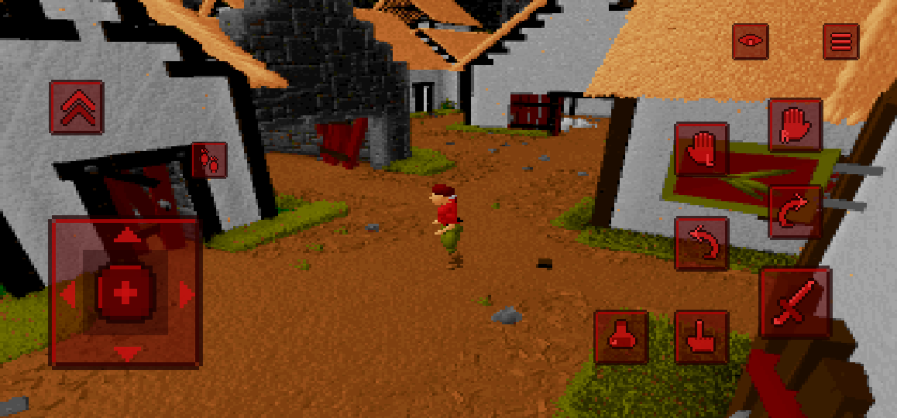
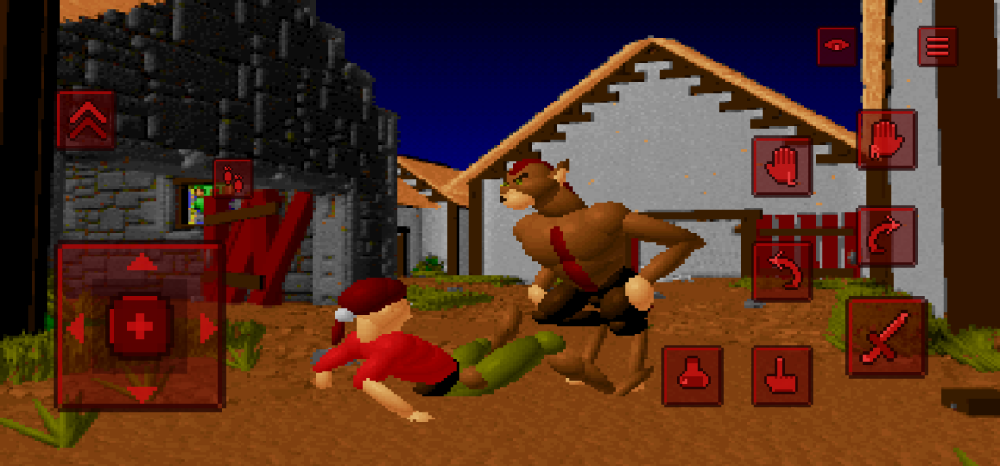

<div align="center">
  
  <h1>Ecstatica — Android Port</h1>
  <p>منفذ Android للعبة Ecstatica، مبني على مشروع المحرك مفتوح المصدر Ecstatica Recompiled.</p>
  <p><a href="README_EN.md">English</a></p>
  <p>
    
    
    
  </p>
</div>

## نبذة

مشروع لتشغيل **Ecstatica (1994)** على Android باستخدام محرك C المعاد تنفيذه ضمن [Ecstatica Recompiled](https://github.com/spacefarergames/EcstaticaRecompiled). يتضمن هذا الإصدار منفذ Android بواجهة لمس وأدوات تحكم قابلة للضبط.

## لقطات من داخل اللعبة

<table>
  <tr>
    <td width="50%"></td>
    <td width="50%"></td>
  </tr>
  <tr>
    <td align="center">واجهة اللعب وأزرار اللمس</td>
    <td align="center">مشهد لعب وعناصر التحكم على الشاشة</td>
  </tr>
</table>

## أبرز تعديلات The Soim

- إضافة عناصر تحكم لمسية بطابع بصري متناسق مع اللعبة، مع عصا تحكم ثابتة أو عائمة وإمكانية تعديل موضع الأزرار وحجمها وشفافيتها.
- دعم اللمس للتنقل في القوائم، إلى جانب دعم أذرع التحكم ولوحة المفاتيح والفأرة.
- إضافة إعدادات Android للصوت والترجمة واللغة وطريقة عرض الصورة والتمويه ودقة إطار العرض.
- إضافة سلوك بدء نظيف للجلسة عند تشغيل اللعبة مجدداً، مع شاشة تشغيل منفصلة عن نشاط اللعب.
- تضمين بيانات اللعبة في الحزمة لتجهيزها تلقائياً عند التشغيل الأول.

للتفاصيل التقنية وحدود المنفذ، راجع [ملاحظات Android](platforms/android/PORT_NOTES.md) و[تعليمات البناء](BUILD_ANDROID.md).

## البناء والتثبيت

المتطلبات: JDK 11 أو أحدث، Android SDK، وNDK `27.2.12479018` مع منصة Android 34 وأدوات البناء `35.0.0`، إضافة إلى CMake وNinja.

```bash
export ANDROID_HOME=/path/to/android-sdk
platforms/android/build.sh v1.0.0
adb install -r platforms/android/build/ecstatica.apk
```

ينتج ملف APK محلياً في `platforms/android/build/ecstatica.apk`. يمكن اختيار ABI واحد مثلاً عبر:

```bash
ABIS="arm64-v8a" platforms/android/build.sh v1.0.0
```

## بنية المشروع

```text
assets/              مواد ورسومات المشروع
decomp/              ملاحظات وملفات فكّ التجميع
docs/                وثائق وصور المشروع
platforms/android/   تطبيق Android وموارده وأصوله
src/                 محرك اللعبة ومصدر C المشترك
```

## المصدر والحقوق والترخيص

- **المشروع الأساسي:** [Ecstatica Recompiled](https://github.com/spacefarergames/EcstaticaRecompiled) من Spacefarer Games. أُبقيت ملفات المصدر والتوثيق والتراخيص الأصلية ضمن المشروع.
- **منفذ Android والتعديلات الخاصة به:** The Soim.
- **ترخيص الشيفرة:** GNU GPL v3؛ راجع ملف [`LICENSE`](LICENSE). هذا الترخيص لا يشمل تلقائياً بيانات اللعبة الأصلية.
- **بيانات اللعبة:** الملف `platforms/android/assets/game.zip` يحتوي بيانات أصلية من Ecstatica. حقوق هذه البيانات تعود إلى أصحابها المعنيين، وهي منفصلة عن ترخيص الشيفرة ومضمّنة بإذن إعادة التوزيع.
- لبيان الإسناد التفصيلي، راجع [`NOTICE.md`](NOTICE.md).

---

<p align="center">منفذ Android وتعديلات The Soim · الإصدار 1.0.0</p>
